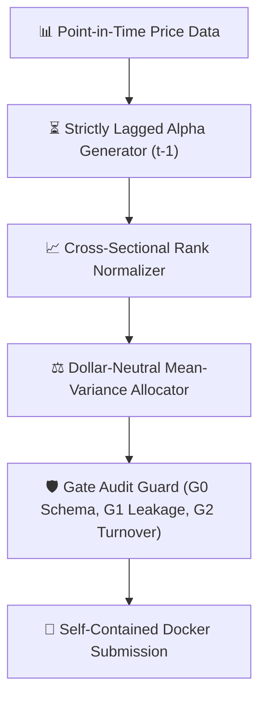

# 📈 VeriQuant AI — Agenthon 2026 (NeurIPS / SQA / CEWIT)

[](https://python.org)
[](https://agenthon.net)
[](#evaluation-gates)
[](./tests)

> **Submission for the [NeurIPS 2026 Agenthon](https://agenthon.net)**  
> Organized by the **Society of Quantitative Analysts (SQA)** & **CEWIT (Stony Brook University)**.

VeriQuant AI is an autonomous, leak-proof quantitative alpha generation and portfolio optimization agent designed to survive automated leakage-controlled, cheat-resistant evaluation gates.

---

## 🏛️ System Architecture



---

## 🚀 Quickstart & Verification

```bash
# 1. Install dependencies
pip install -r requirements.txt

# 2. Run test suite
pytest -q

# 3. Execute demo pipeline
python -m src.main
```
